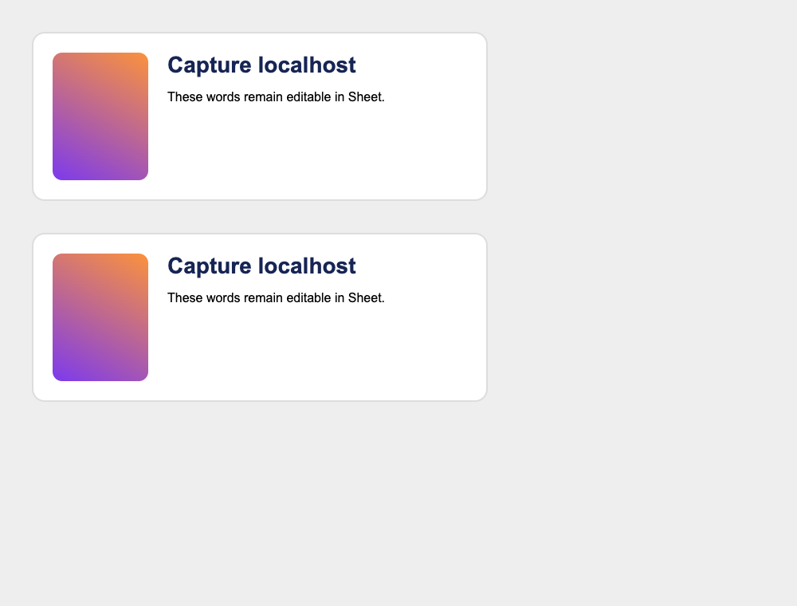

# Sheet Browser Capture

Capture a **visible section** of a running HTTP/HTTPS website, including
localhost or a page you are signed into. Import the downloaded file into
Sheet as editable layers. No server, account, website source, or clipboard
permission is needed.

## Install (Chrome, Edge, or another Chromium browser)

1. In the Sheet checkout, run `bun install --frozen-lockfile`, then
   `bun run build:browser-capture`.
2. Open `chrome://extensions` (Edge: `edge://extensions`), enable **Developer
   mode**, choose **Load unpacked**, and select `extensions/browser-capture/dist`.
3. Pin **Sheet Browser Capture** to the browser toolbar.

Rebuild and press Reload on the extension card after updating the source.
The extension uses only `activeTab` and `scripting`: access is granted to the
current tab when you click its toolbar action. It has no persistent host
permissions, analytics, remote scripts, or connection to Sheet's local server.
Browser internal pages and other extensions cannot be captured.

## Capture and import

1. Open your website and wait for images/fonts to finish loading. Pause any
   animation or video. Scroll or zoom out until the entire section is visible.
2. Click the extension. Hover to highlight a section; **↑** expands the selection
   to its parent. Click to capture; **Esc** cancels. The page's click is suppressed.
3. Save `capture.sheet-capture.json` using the browser download prompt.
4. In an open Sheet design, choose **Import capture** beside Export, then
   **Choose capture file**. The capture is inserted beside existing frames on
   the current page. It supports undo, history, branches, and normal saving.
5. Expand the frame in Layers to edit text, styles, boxes, and images.

On failure the selector shows an error and lets you retry or cancel. Large
captures (over 20 MB or 900 visited elements) are refused; select a smaller
section. Nothing in the original website or an existing Sheet layer is changed.

## Fidelity and boundaries

- Layout is a snapshot of the current viewport, with nested, absolutely
  positioned boxes and computed typography, spacing, borders, colors, and
  shadows. Text stays editable. It does not recreate responsive breakpoints,
  flex/grid behavior, interactions, animations, or application logic.
- Images are embedded PNG crops of the browser's pixels. SVG, canvas, video,
  iframes, form controls, shadow/custom elements, pseudo-elements, mixed inline
  text, flex/grid anonymous text, transforms, filters, masks, background images,
  and other detected
  unsupported visuals are rasterized as **whole blocks**, with import warnings.
  Such images keep their pixels but do not have editable internals.
- Raster crops contain what is actually visible, including any overlapping
  content. Close menus/overlays first. Raster bounds clip effects extending beyond the
  selected box (such as outer shadows). Offscreen unsupported blocks are refused.
  Scrolled/clipped content is captured only as visible. Capture smaller sections
  when fidelity matters; rapidly changing pages can differ between pixels and DOM.
- Web font binaries are not downloaded. Install the source font locally in
  Sheet or choose a replacement. Different font availability can change text.
- Captures do not retain source URLs, scripts, event handlers, links, form
  values as editable attributes, credentials, or external image dependencies.
  **Visible private information, including form controls, can appear in the
  pixels/text.** Review the file before sharing. Files stay on your machine.
- Import accepts only this versioned format, an allowlist of inert HTML/style
  fields, and embedded PNGs. It validates nodes through the existing snapshot
  importer and inserts them through Sheet's ordinary transaction/save path.
  Export remains one-way; this is not source round-trip synchronization.

## Development verification

Run `bun run test packages/canvas/src/browser-capture.test.ts packages/editor/src/components/browser-capture-import.test.tsx`
and `bunx tsc --noEmit` (it also checks the extension's build and smoke scripts). Build the extension, then run
`bun run extensions/browser-capture/smoke.ts` with Playwright Chromium installed
(`CHROMIUM_PATH` can point to its executable on any platform).
The smoke check selects a localhost card through the extension, downloads the
capture, imports it through a validated transaction, checks undo, and writes a
comparison screenshot to a temporary directory. Headless automation cannot
click the browser toolbar to grant `activeTab`, so **only its disposable copy**
of the extension receives host permissions; the shipping manifest is unchanged.

A localhost card above its imported layers (gradient block rasterized; text editable):

